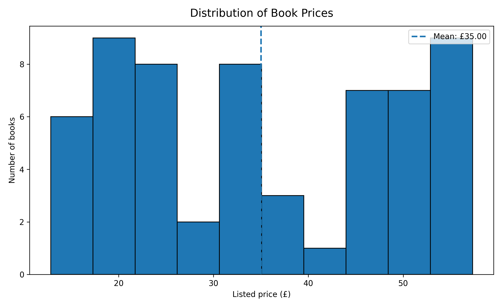
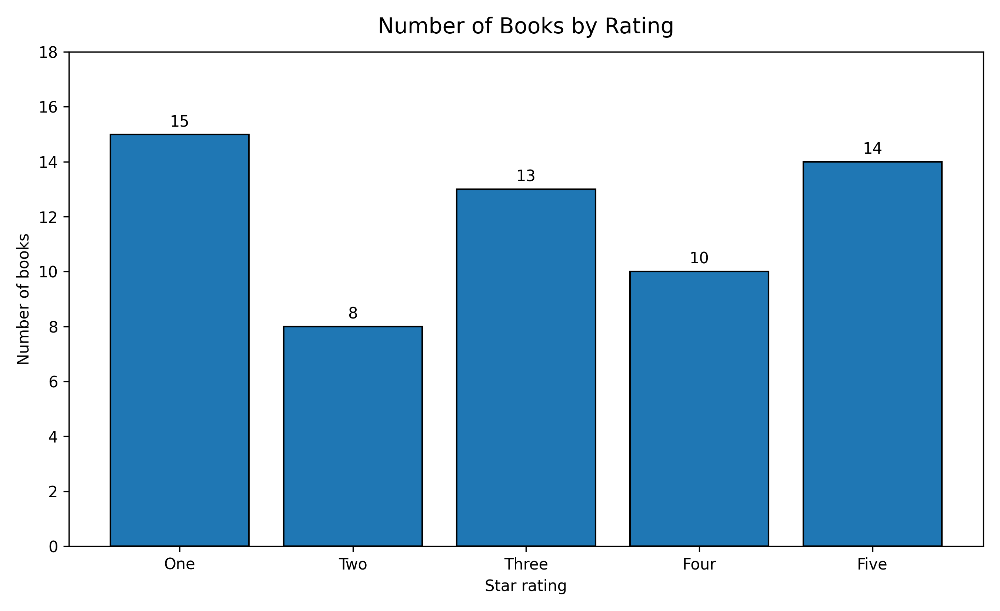
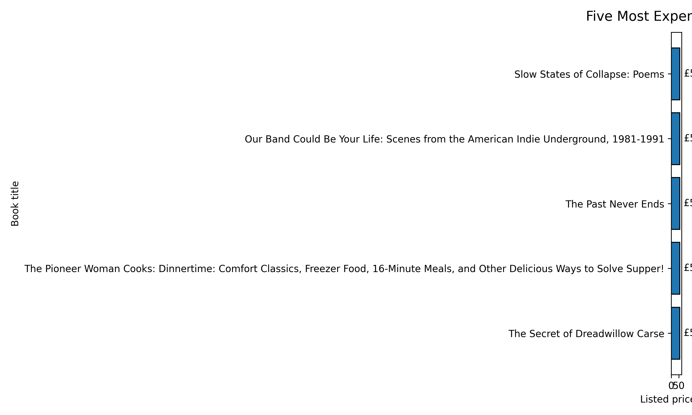
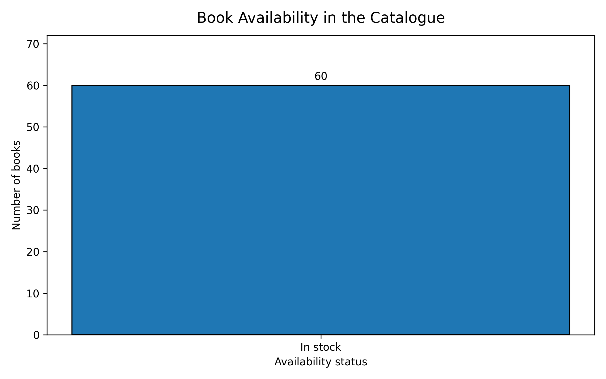
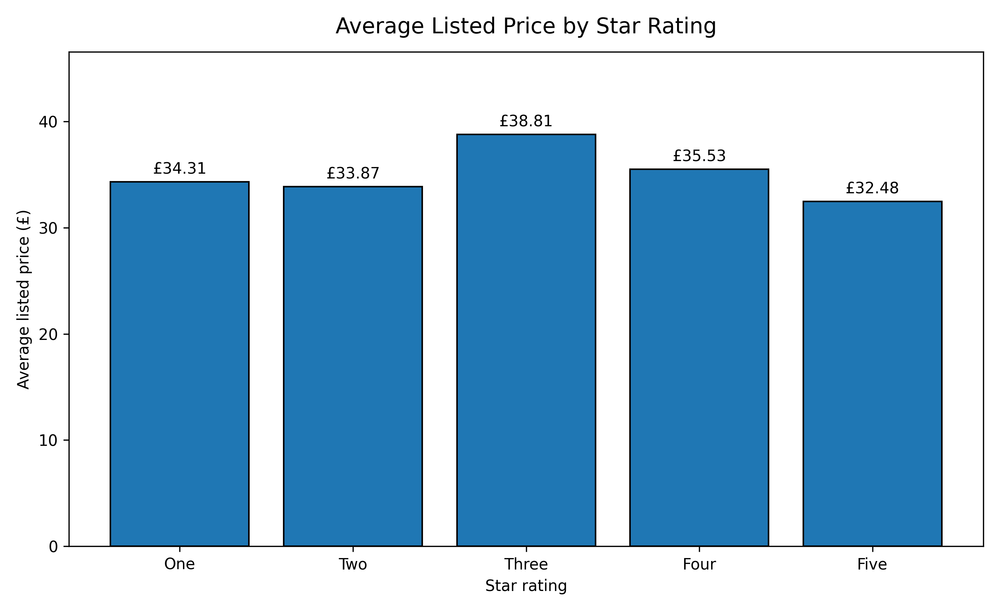
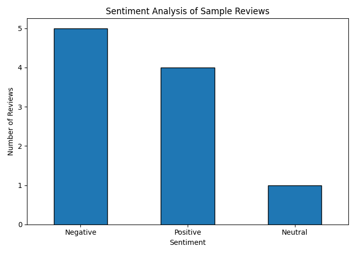

# E-Commerce Data Analytics

A Python portfolio project demonstrating web scraping, exploratory data analysis (EDA), data visualization, and sentiment analysis.

## Project Overview

This project collects book catalogue information from [Books to Scrape](https://books.toscrape.com/), analyzes product prices and ratings, creates visualizations, and demonstrates sentiment analysis using VADER.

**Dataset note:** The catalogue data represents listed books, not sales transactions. Sentiment analysis uses sample review text, not genuine customer feedback.

## Technologies

- Python
- Requests
- Beautiful Soup
- Pandas
- Matplotlib
- Seaborn
- VADER Sentiment

## Project Structure

```text
Ecommerce_Data_Analytics/
├── data/
│   ├── scraped_products.csv
│   └── sample_sentiment_results.csv
├── results/
│   ├── eda_report.txt
│   ├── price_distribution.png
│   ├── products_by_rating.png
│   ├── top_five_expensive.png
│   ├── product_availability.png
│   ├── average_price_by_rating.png
│   └── sentiment_analysis.png
├── task1_web_scraping/
│   └── scrape_products.py
├── task2_eda/
│   └── eda_analysis.py
├── task3_visualization/
│   └── visualize_data.py
├── task4_sentiment_analysis/
│   └── sentiment_analysis.py
├── requirements.txt
└── README.md
````

## Tasks

### Task 1 — Web Scraping

Collects product names, prices, availability, and ratings from the Books to Scrape catalogue.

Script: `task1_web_scraping/scrape_products.py`

Output: `data/scraped_products.csv`

### Task 2 — Exploratory Data Analysis

Examines dataset dimensions, missing values, duplicate products, price statistics, ratings, and availability.

Script: `task2_eda/eda_analysis.py`

Output: `results/eda_report.txt`

### Task 3 — Data Visualization

Creates charts showing price distribution, rating counts, the five most expensive listed products, availability, and average price by rating.

Script: `task3_visualization/visualize_data.py`

Charts: `results/`

### Task 4 — Sentiment Analysis

Uses VADER to classify sample reviews as positive, neutral, or negative.

Script: `task4_sentiment_analysis/sentiment_analysis.py`

Outputs:

* `data/sample_sentiment_results.csv`
* `results/sentiment_analysis.png`

## Visualizations

### Price Distribution



### Products by Rating



### Top Five Expensive Products



### Product Availability



### Average Price by Rating



### Sample Review Sentiment



## Setup

### 1. Clone the repository

```bash
git clone https://github.com/ShaikMuskan0414/Ecommerce_Data_Analytics.git
cd Ecommerce_Data_Analytics
```

### 2. Create and activate a virtual environment

macOS/Linux:

```bash
python3 -m venv venv
source venv/bin/activate
```

Windows:

```bash
python -m venv venv
venv\Scripts\activate
```

### 3. Install dependencies

```bash
python -m pip install -r requirements.txt
```

## Run the Project

Run these commands from the project root:

```bash
python task1_web_scraping/scrape_products.py
python task2_eda/eda_analysis.py
python task3_visualization/visualize_data.py
python task4_sentiment_analysis/sentiment_analysis.py
```

On macOS, use `python3` if `python` is unavailable.

The scraping task requires an internet connection. The other tasks use local data or sample text as implemented.

## Key Findings

The current scraped dataset contains 60 book listings, all marked as in stock in the collected snapshot. The dataset describes catalogue information and does not establish sales, revenue, or customer purchasing behavior.

The sentiment analysis demonstrates a text-classification workflow on sample reviews only.

## Limitations

* The scraped catalogue is a limited snapshot and may change.
* Catalogue prices and ratings are not sales or revenue data.
* Sample reviews do not represent real customer feedback.
* VADER is rule-based, so sentiment labels may not match human judgments.

## Future Improvements

* Analyze a larger product catalogue.
* Use genuine reviews where collection is permitted.
* Compare sentiment across product categories.
* Add further statistical analysis and interactive visualizations.

## Author

Shaik Muskan

## License

Educational and portfolio project.
